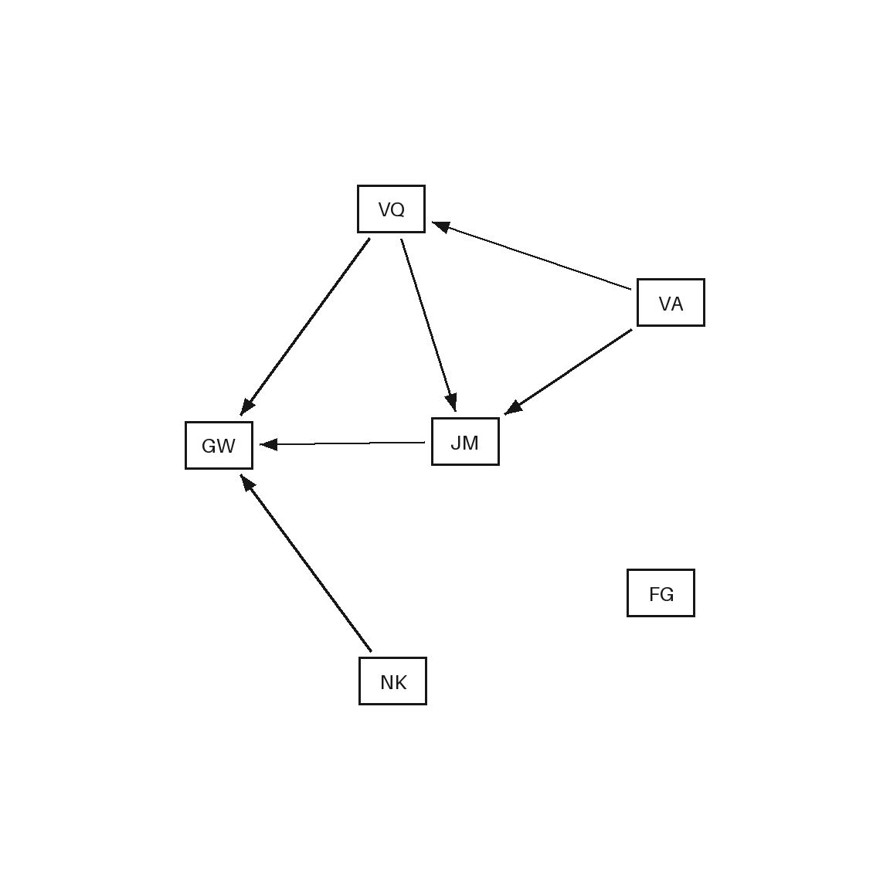
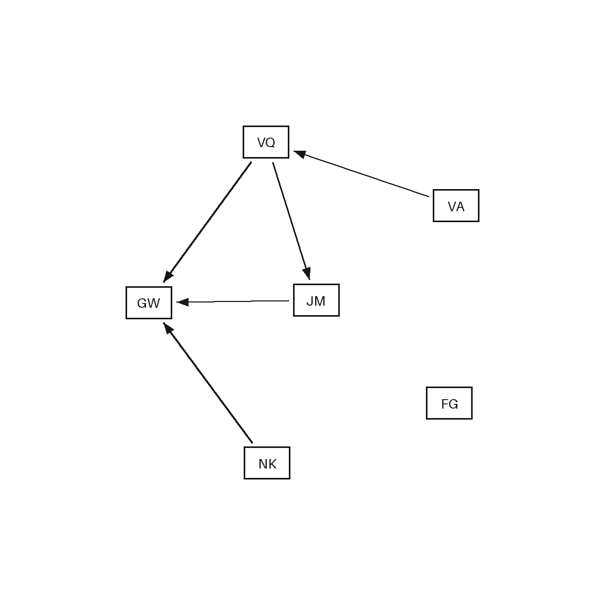

# TopoDelta-QA · directed graph edits and question answering

**Synthetic dataset; 200-group agent visual audit; no human validation or model
benchmarking performed.** The audit also inspected 16 additional high-risk groups
(216 distinct groups / 864 images total). This is a local research release
candidate, without a claim of established novelty or publication readiness.

Start with the [16-group gallery](instructor_demo/gallery.html), the
[five-minute instructor script](instructor_demo/INSTRUCTOR_SUMMARY.md), and the
[small annotation example](instructor_demo/annotation_example.json). Clone or
download this repository and open `instructor_demo/gallery.html` locally. GitHub's
file view shows HTML source; no hosted gallery or dataset download is claimed.
The gallery contains all four images, both questions, saved answers, signed edge
changes and supporting evidence for every selected group. Answers are algorithmic
annotations, never model predictions.

## Three comparison cases

The central question is whether a visual change matters to a particular question.
Each base group has two questions and four images: an original, a redraw, and two
single-operation edits independently applied to the original.

| Original compared with | Graph change | Answer effect | Comparisons |
| --- | --- | --- | ---: |
| Redraw | Complete labeled graph preserved; appearance changes | Unchanged | 40,000 |
| Irrelevant edit | Add, delete or reverse an edge | Unchanged for this question | 58,914 |
| Relevant edit | Add, delete or reverse an edge | Changes for this question | 21,086 |

These 120,000 comparisons are correlated within groups; they are not independent
graph samples. Question types are direct-edge presence, directed reachability and
shortest-path length. Reversal counts as **one operation with two directed-edge
differences**. The changed-edge delta is separate from answer-supporting evidence.

### Same edit, two questions

In [the first gallery group](instructor_demo/gallery.html#g-cb2cb52cb5e1d654b236734a),
delete **VA → JM**. The direct-edge answer changes **true → false**. Reachability
stays **true** because **VA → VQ → JM** survives. The same edit is relevant to one
question and irrelevant to the other. Its complete saved record and certificates
are [included](instructor_demo/samples/cb2cb52cb5e1d654b236734a.json).

| Original | Delete VA → JM |
| --- | --- |
|  |  |

## Verified current release · v0.3.0-rc1

| Unit | Count |
| --- | ---: |
| Base groups | 20,000 |
| Diagrams | 80,000 |
| PNG / SVG assets | 80,000 / 80,000 |
| Single-image QA instances | 160,000 |
| Original–variant–question comparisons | 120,000 |
| Train / validation / test groups | 14,000 / 3,000 / 3,000 |

Graphs have 6–20 nodes. Size bands 6–8 / 9–12 / 13–16 / 17–20 contain
4,000 / 4,000 / 6,000 / 6,000 groups. DAG/cyclic counts are 10,000 each;
connected/disconnected counts are 15,226/4,774. Four styles have 5,000 groups each.
Layouts are grid 5,058, staggered layers 5,063, radial 5,060 and concentric 4,819.
See [all distributions and definitions](instructor_demo/README.md),
[coverage](instructor_demo/reports/coverage_summary.json),
[task counts](instructor_demo/reports/tasks.csv),
[edit counts](instructor_demo/reports/operations.csv),
[answer transitions](instructor_demo/reports/answer_transitions.csv), and
[acceptance/rejections](instructor_demo/reports/acceptance_by_size.csv).

Counts were reconciled with the actual saved manifest. Its SHA-256 is
`10fcb8dd41f48542301f22dd09f4bbb553095333335a3db7427a098bced09e0a`;
[the header receipt](instructor_demo/reports/release_manifest_summary.json)
and [source-copy provenance](instructor_demo/selection.json) are included.

## Code, schema and checks

- [Release generator](topodelta_qa/release/build.py),
  [independent raw-JSON verifier](topodelta_qa/release/independent.py),
  [saved-image validation](topodelta_qa/release/verify.py), and
  [split/isomorphism audit](topodelta_qa/release/split_audit.py).
- [CLI](topodelta_qa/cli.py), [evaluator](topodelta_qa/evaluate.py) and [tests](tests/).
  The evaluator supports the historical 6–12-node pilot protocol; it is **not**
  an evaluator for the current 20-node release. No release baseline was run.
- [Canonical group schema](instructor_demo/reports/group.schema.json),
  [readable JSON projection](instructor_demo/annotation_example.json), and 16
  complete saved records in `instructor_demo/samples/`.
- [Runtime pins](requirements.txt), [test dependency](requirements-dev.txt),
  [recorded environment](instructor_demo/reports/environment.json), and
  [generation configuration](configs/release_candidate.json).

```sh
# Existing CPython 3.12.6 environment; no inference or model download.
PYTHONPATH=. python3 scripts/instructor_demo.py build
PYTHONPATH=. python3 scripts/instructor_demo.py verify
python3 -m unittest discover -s tests -p 'test_instructor_demo.py' -v
python3 -m topodelta_qa --help
```

[Reproduction instructions](docs/REPRODUCTION.md) separate the self-contained
sample demo from exact full-release regeneration, which requires local historical
inputs and an evaluator identity key excluded from Git. The independent demo check
recomputes 128 answers, 128 certificates and 32 edits. Full-release validation,
split/export checks and a complete second regeneration are documented in the
[actual release report](docs/RELEASE_CANDIDATE_REPORT.md),
[closeout](docs/RELEASE_CANDIDATE_CLOSEOUT.md), and
[completed/running/pending status table](instructor_demo/STATUS.md).

## Availability and limitations

This repository includes source, documentation, schemas, curated saved reports
and **16 training groups / 64 sample PNGs**. The full sealed 20,000-group dataset,
complete regeneration, archives and existing review materials remain locally in
`outputs/` (release: `outputs/topodelta_qa_v0.3.0-rc1`). They are not uploaded or
ordinary Git history. There is no public full-dataset download link at present.
Credentials, evaluator identity keys, caches and temporary files are excluded.

Deterministic correctness checks establish the implemented graph/rendering
properties; agent visual inspection is a sampled judgment of apparent readability.
It does not establish human readability or inter-rater agreement. HTML browser
inspection remains **pending** because preview tools were unavailable; static
links and saved PNGs were checked. SVGs were not independently browser-rasterized.

The known redraw/style shortcut makes redraw comparisons easier to identify;
report redraw invariance separately from edit sensitivity. Planar templates,
sampling bias (especially six-node rejection sampling), and 134 empty coverage
cells limit generality. Small marginal shortcut associations do not prove absence
of leakage. No learned verifier, model training or paid API experiment was run.
License selection and font redistribution provenance remain author decisions;
this repository does not grant a dataset or code license. No standalone font is
included in this small sample bundle.

[Repository preparation and check evidence](docs/REPOSITORY_PREPARATION.md)
records what was included and preserved. Historical Phase 2A/2B scaffolding remains
for provenance; **Phase 2B live inference is cancelled**. Historical records below
use their original version counts and local-only links; current status is above.

<details>
<summary>Historical Phase 1 README — original text preserved</summary>

# TopoDelta-QA · Phase 1

**Current mode: dataset creation only. Phase 2B inference is cancelled.**
Completed: **1,000 groups** in [v0.2.0](outputs/topodelta_qa_v0.2.0/DATASET_CARD.md), including 120 retained pilot groups and 880 additions. Generation, rendering, algorithmic annotation and automated validation ran locally. No model inference, paid APIs, training or downloads. See [the build report](docs/DATASET_1000_REPORT.md) and [active workflow](docs/DATASET_ONLY.md).


A local, reproducible synthetic pilot for question-conditioned topology changes
in directed graph diagrams. Novelty and method superiority remain unverified.
Gold answers come from deterministic algorithms, never an LLM.

Phase 1B: see [the independent audit](docs/PHASE1B_AUDIT.md) and
[blank 120-group human-review packet](outputs/phase1b/human_review/packet/index.html).
The original pilot is preserved in `outputs/versions/phase1-v0.1.0/` and its sealed
archive; the original `outputs/pilot` remains unchanged. Corrected version 0.1.1 replaces
public identifiers, filenames, and metadata while preserving every graph, answer,
and image byte. Verifier patch 0.1.2 reports
historical source differences and strictly validates integer edit counts. The
original version is blocked for baseline use because public IDs and file times
revealed variant roles. Use the corrected version and keep its evaluator-only
`gold/id_key.json`, the reproduction key in `configs/evaluator_id_key.json`, and
all legacy-version metadata outside the inference runner.

The preserved 120-group pilot is in `outputs/pilot_v0.1.1/`. Start with its
[dataset card](outputs/pilot_v0.1.1/DATASET_CARD.md), [audit](outputs/pilot_v0.1.1/reports/audit.json),
[generation report](outputs/pilot_v0.1.1/reports/generation.json), and
[contact sheet](outputs/pilot_v0.1.1/reports/contact_sheet.png).
Automated checks are separate from human review: **human visual validation has
not occurred**. No model inference or learned verifier is included.

## Environment and commands

The verified environment is CPython **3.12.6**, NetworkX **3.6.1**, Pillow
**12.3.0**, and PyYAML **6.0.3**. `.python-version` and `requirements.txt` pin these.
No model, system renderer, external font, GPU, API key, or paid service is needed.
SVG and PNG use a shared primitive scene; Pillow supplies its embedded Aileron
Regular font. SVG embeds that font, so system font substitution is unnecessary.

From this project directory, in an environment with those dependencies:

```sh
python3 -m topodelta_qa generate --config configs/pilot.yaml
python3 -m topodelta_qa validate --dataset outputs/pilot_v0.1.1
python3 -m topodelta_qa audit --dataset outputs/pilot_v0.1.1
python3 -m topodelta_qa evaluate --dataset outputs/pilot_v0.1.1 --predictions predictions.jsonl
python3 -m topodelta_qa evaluate --dataset outputs/pilot_v0.1.1 --predictions paired_predictions.jsonl --protocol paired
python3 -m unittest discover -s tests -v
```

Generation refuses to overwrite an existing directory. The delivered pilot already
exists; reproduce into a fresh directory:

```sh
python3 -m topodelta_qa generate --config configs/pilot.yaml --output outputs/pilot_v0.1.1_repeat
python3 -m topodelta_qa validate --dataset outputs/pilot_v0.1.1_repeat
python3 -c 'import json; from pathlib import Path; a=json.loads(Path("outputs/pilot_v0.1.1/manifest.json").read_text()); b=json.loads(Path("outputs/pilot_v0.1.1_repeat/manifest.json").read_text()); assert a["files"] == b["files"]; print("Identical dataset payload hashes; inspect manifest provenance separately")'
```

Validation checks every listed file against its hash and regenerates the image
primitives. Comparing the validated file-hash maps covers every payload file. Verifier patches
change source hashes inside manifest provenance; those differences are expected.
For byte-identical historical manifests, use the frozen source snapshot as
documented in the Phase 1B audit. Timestamps
and absolute output paths are excluded. Reproduction assumes the pinned Python
and library builds; PNG bytes across other FreeType/zlib builds are not promised.
The small repeat-generation test compares every byte, including the manifest.
The delivered verification report also records a complete 120-group repeat run.

For a clean environment, use CPython 3.12.6 and install `requirements.txt` in a
virtual environment. If the pinned libraries are already installed locally,
this offline setup also exposes the `topodelta` console command:

```sh
python3 -m venv --system-site-packages .venv
.venv/bin/python -m pip install --no-index --no-deps --no-build-isolation -e .
.venv/bin/topodelta --help
```

The offline installation requires the pinned build tool, setuptools 84.0.0,
to be available locally. The module commands above need no package installation.
The three runtime dependencies have no additional runtime dependency tree.

## Layout and scope

- `topodelta_qa/schema.py`: typed graph/config/question and serialized-record contracts.
- `semantics.py`: NetworkX solver, independent BFS/relaxation, edits, certificates,
  and exact directed isomorphism checks.
- `render.py`: geometry, shared SVG/PNG rendering, clearance validation.
- `dataset.py`: seeded sampling, rejection accounting, splits, exports, audit,
  dataset card, contact sheet, and provenance manifest.
- `verify.py`: saved-data integrity, independent semantic checks, rendering
  regeneration, delta footprint checks, isolation, and export allowlists.
- `evaluate.py`: protocol-specific accuracy, evidence/delta metrics, and group bootstrap.
- `cli.py`: generation, validation, audit, and evaluation commands.
- `tests/test_pilot.py`: semantic, geometry, leakage, metric, failure, and reproduction checks.

Each accepted group has 6–12 nodes, four variants, and two shared questions. One
variant redraws exactly the same labeled graph. Each edited variant independently
adds, deletes, or reverses one original edge. At least one edit changes one answer
and preserves the other. Edits preserve every unchanged route, node position,
label, style, and canvas. Reversals count as one operation and two directed edge
set differences. Answer evidence and changed-edge annotations are separate.

Graph sampling uses randomly directed subsets of convex-polygon triangulations.
Generation rejects invalid geometry and cross-split isomorphism duplicates. All
four variants are checked against all variants in other splits, ignoring labels;
exact VF2 checks make the final duplicate decision. Within-split duplicates are
allowed. Task-pair and operation schedules are separately shuffled and balanced;
styles are independently sampled. See the card for acceptance and selection bias.

## Inference boundary

Give a baseline runner **only `outputs/pilot_v0.1.1/inference/`**. It contains neutral
assets, public questions, and [protocol instructions](outputs/pilot_v0.1.1/inference/README.md).
PNG paths are relative to that directory. Runner metadata can identify groups and
splits, but single-image model calls receive only the current image, question,
answer format, and generic instructions. No other cases or images are context.
Paired calls receive exactly their ordered two images and current question.

Keep `gold/`, `reports/`, `DATASET_CARD.md`, and `manifest.json` with the evaluator.
They contain privileged graph structure, answers, relevance, certificates,
semantic deltas, and pixel differences. Public row keys are validated by exact
allowlists. Inputs contain neither edit-operation nor relevance hints.

Prediction formats, negative evidence, and alternative valid paths are documented
in the inference README. [Metric definitions](docs/METRICS.md) explain denominators,
empty sets, invalid/missing fields, joint success, and uncertainty intervals.
Choose `--split test` for test-only evaluation. Use `--output outputs/evaluation.json`
to save a report outside the sealed dataset; protocol and split are recorded.

Generation writes partial gold and explicit attempt/rejection reports before
raising an error if its attempt budget is exhausted. It never relabels failed
candidates to reach the quota. It never filters on VLM success or failure.

Recorded automated results and exact commands are in
[Phase 1B audit](docs/PHASE1B_AUDIT.md) and [current raw test output](outputs/phase1b/test_results.txt).
The [Phase 1 verification record](docs/VERIFICATION.md) documents the earlier frozen source version.
Remaining research decisions include human legibility review, broader graph and
rendering families, answer/relevance balancing, model baselines, evidence
elicitation, external validity, novelty review, and release licensing.


## Phase 2A baseline harness

The [baseline protocol](docs/BASELINE_PROTOCOL.md) and frozen
[prompt templates](prompts/phase2a/) define direct VLM, parse-then-solve and
privileged oracle tracks. [The runbook](docs/BASELINE_RUNBOOK.md) gives commands,
isolation requirements, safe resume and the proposed model/budget.
[The Phase 2A report](docs/PHASE2A_REPORT.md) records local checks and results.

For these experiments, give the provider worker only the newly prepared
`outputs/phase2a/worker/` bundle and installed code in an isolated environment.
It is narrower than the historical inference export: PNG bytes and current question
only reach the model, paired order is randomized, and no SVG or original-first hint
is sent. Keep `outputs/phase2a/evaluation/` and every dataset/gold/old-release/report
folder off the worker. The worker CLI is `python3 -m topodelta_qa.baselines run`;
preparation and offline scoring are separate commands. Never put API keys in config.

No real provider inference has run. The example budget is a proposal, not approval;
null reservation settings and an authorization gate deliberately prevent dispatch.
The 18-group validation oracle sanity check is privileged access, not VLM performance.
Test predictions remain absent. There is no learned topology-delta verifier.

</details>
